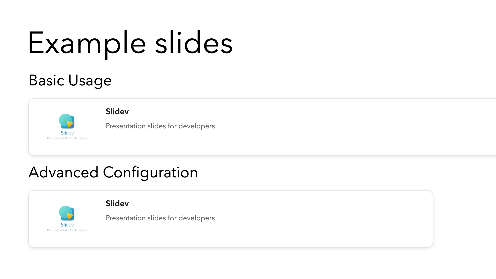

# Slidev OGP Image Add-on

A Slidev addon that displays Open Graph Protocol (OGP) data from URLs as interactive cards in your presentations.

## Features

- **OGP Data Display**: Renders Open Graph meta tags as formatted cards
- **Vue Component Integration**: Provides a reusable Vue component for Slidev
- **Interactive Cards**: Displays clickable cards with page information
- **Error Handling**: Graceful fallbacks when OGP data is unavailable
- **Click-to-Open**: Opens URLs in new tabs when cards are clicked

## Example

[example.md](./example.md)  


## Installation

```bash
npm i @katzumi/slidev-addon-ogp-image
```

## Usage

Add the addon to your `slides.md` frontmatter:

```yaml
---
addons:
  - "@katzumi/slidev-addon-ogp-image"
---
```

Use the component in your slides:

```vue
<OgpImage url="https://github.com/k2tzumi/slidev-addon-ogp-image" />

<OgpImage 
  url="https://github.com/k2tzumi/slidev-addon-ogp-image"
  :width="800"
  :height="400"
  :timeout-ms="20000"
/>
```

## Component Properties

- `url` (required): URL to fetch OGP data from
- `width`: Display width for the card (default: 1200px)
- `height`: Display height for the card (default: 630px)
- `timeoutMs`: Maximum total time in milliseconds for all OGP fetch attempts (default: 15000; clamped to 1–60000)

### Fetch behavior

- During local Slidev development, the addon first fetches page HTML through a same-origin endpoint provided by the Vite dev server. This avoids browser CORS restrictions for the initial request.
- If the local endpoint is unavailable or the request fails, the component tries the existing public CORS proxies.
- The local endpoint is available only while the development server is running. Static HTML exports and deployed static sites do not include it; those environments use the public-proxy fallback.
- If all fetch attempts fail, the component renders a usable card with the target domain instead of replacing the card with an error screen.
- The local proxy accepts only HTTP(S) URLs resolving to public IP addresses, follows and revalidates redirects, and limits HTML responses to 2 MB. These checks reduce SSRF risk but cannot guarantee that every remote host is reachable or safe.

## Project Structure

```
slidev-addon-ogp-image/
├── index.ts                    # Main addon entry point
├── setup/
│   └── main.ts                # Client setup
├── lib/
│   └── ogp-generator.ts       # OGP fetching and processing logic
├── server/
│   └── ogp-proxy.ts           # Development-server-only HTML proxy
├── components/
│   └── OgpImage.vue           # Vue component
└── assets/
    └── NotoSansJP-Bold.ttf    # Optional font file
```

## Examples

### Single Link

```markdown
---
addons:
  - "@katzumi/slidev-addon-ogp-image"
---

# Check out this resource

<OgpImage url="https://docs.microsoft.com/en-us/azure/" />
```

### Multiple Links

```markdown
---
# Multiple Links

<div class="grid grid-cols-2 gap-4">
  <OgpImage url="https://vuejs.org/" />
  <OgpImage url="https://react.dev/" />
</div>
```

## Technical Limitations

### Browser Security Restrictions

During local development, remote HTML is fetched by the local Vite server to avoid browser CORS restrictions. Static exports and deployed static hosting have no server-side endpoint, so fetching depends on the public CORS proxy fallback and its availability. The timeout applies to the complete sequence of local and public proxy attempts.

### Recommended Usage

- **Development**: Suitable for development and demonstration purposes
- **Production**: Consider server-side OGP fetching for production environments
- **Fallbacks**: Always provide fallback content when OGP data is unavailable

## Browser Compatibility

- Modern browsers with ES2015+ support
- Chrome 60+
- Firefox 55+
- Safari 11+
- Edge 79+

## Development

### Setup

```bash
# Install dependencies
npm install

# Build the addon
npm run build

# Watch mode for development
npm run dev
```

### Local Development

The addon is designed to work as a local addon in your Slidev project. For development:

1. Clone this repository
2. Install dependencies
3. Link to your Slidev project for testing

## Contributing

Contributions are welcome! Please ensure all code follows the project's coding standards and includes appropriate tests.

## License

MIT License - see LICENSE file for details.

## Acknowledgments

This addon builds upon the Slidev ecosystem and leverages Vue.js component architecture for seamless integration with presentation workflows.